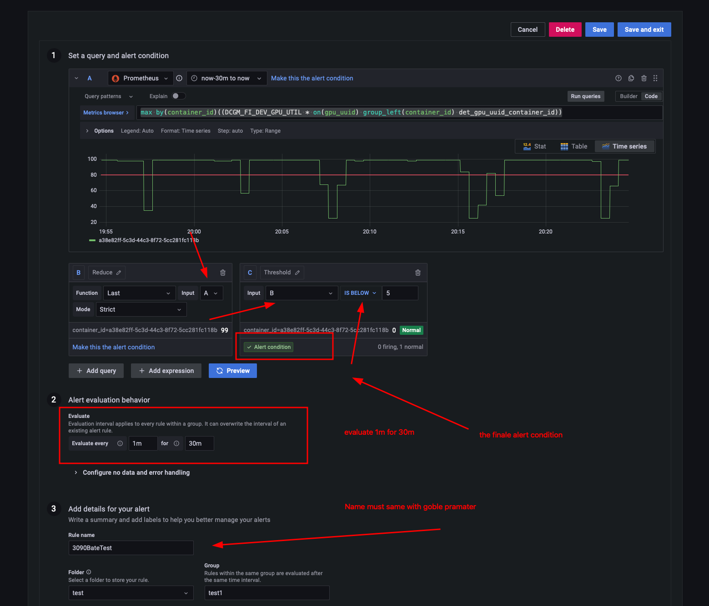

# Determined watchdog

Reclaims idle GPU shells and JupyterLab notebooks on the Determined cluster and keeps the
Determined API token that Prometheus uses for the `det-master` scrape fresh. Runs as the
`watchdog` service in `services/docker-compose.yml` (image built from `build/`).

## What it does

Every 30 minutes, at minutes 0 and 30 (crontab `*/30 * * * *`, see `WATCHDOG_SCHEDULE` in
[Configuration](#configuration)), it:

1. **Checks the Determined token** (see [Determined token](#determined-token-shared-with-prometheus)) and renews it if needed.
2. **Fetches the firing alerts** from Grafana's Alertmanager API
   (`/api/alertmanager/grafana/api/v2/alerts/?active=true&silenced=false&inhibited=false`).
   Silenced and inhibited alerts are ignored, so **a Grafana silence on
   `IdleKillAlert{container_id="..."}` exempts that container** (shell or notebook) from being
   killed.
3. If the alert named `GRAFANA_ALERT_NAME` is firing, maps its `container_id` labels to Determined
   **shells** and **JupyterLab notebooks** (`/api/v1/shells/` and `/api/v1/notebooks/`, plus
   `/api/v1/tasks/`: allocation `<shell or notebook id>.1` -> `containerId`). Both kinds are
   handled alike:
   - a shell or notebook that is idle for the first time gets a Slack **Warning**
     ("Your container will be released in 30 minutes": one interval of the schedule);
   - one that was already warned at the previous check (at least 15 and at most 45 minutes
     earlier, `warning_min_age_minutes` / `warning_max_age_minutes`: half an interval and one and
     a half) and is still idle is killed
     (`POST /api/v1/shells/<id>/kill` or `POST /api/v1/notebooks/<id>/kill`).
     It is reported as **Terminated** only if the kill succeeded; a failed kill is logged, not
     reported, and retried at the next check.

Only shells and JupyterLab notebooks are policed: idle commands, TensorBoards and trials are never
killed. Notebooks are policed because Determined gives a notebook's Jupyter token only to its owner
and to admins, so nobody else can check or reclaim an idle notebook by hand. A CPU-only shell or
notebook has no GPU metrics, so the alert never fires for it and it is never warned or killed.
If the alert is not firing, or no idle container belongs to a shell or notebook, it only logs.
Errors (Grafana/Determined/Slack unreachable, bad responses) are logged and the next check tries
again; Slack delivery is best-effort and never stops the watchdog. The shell and notebook listings
fail independently: if one of them fails, the check posts `det api miss` naming it and polices
the other kind as usual. Tasks of the failed kind are neither warned nor killed in that check; the
ones warned before and still idle stay tracked, so the next check that lists them kills them if
they are still idle, without a second warning. If the task listing fails, or both the shell and
the notebook listings, the check posts `det api miss` and neither warns nor kills.
The warning state (`data/file_info.json` + `data/localData/`) survives restarts. A warning older
than 45 minutes (after downtime, or after a check at which no shell or notebook was idle) is
ignored and that shell or notebook is warned again.

The checks are scheduled with APScheduler (a cron trigger, in the container's local timezone: UTC,
as the compose file sets no `TZ`). A check that starts more than 5 minutes late (host suspended or
overloaded) is skipped and logged as `check missed`; a check never starts while the previous one
is still running. Each step of a check has its own error handling, and an error that escapes a
check is logged; neither stops the schedule.

At start it runs the same token check once, **silently**: it only logs, so a restart or redeploy
posts nothing to Slack (details in [Determined token](#determined-token-shared-with-prometheus)).
A start never runs a check: the first one is the next fire time of the schedule (logged as
`Check schedule: */30 * * * * (every 30 min); next check at ...`), so the watchdog can be
restarted at any time. A check that comes less than 15 minutes (`warning_min_age_minutes`) after
the previous saved one does nothing (e.g. right after `WATCHDOG_SCHEDULE` moved the check
minutes), so the shells and notebooks warned by that one still get the full interval. A check that
is running when the container stops finishes first if it takes less than Docker's stop timeout
(10 s).

### Slack messages

| Message | Sent by |
| --- | --- |
| **Warning** / **Terminated**: one field per shell or notebook, titled `[Shell] <description>` or `[JupyterLab] <description>`, with its user | check: idle shells and notebooks warned / killed |
| `Automatic update success ~` | check that renewed the Determined token; a renewal after HTTP 401 |
| `Automatic update FAILED ~ (<reason>)` | check whose renewal failed (repeated at every check until it works); a failed renewal after HTTP 401 |
| `Failed to fetch Grafana alert! Reason: empty response.` | check: Grafana unreachable or bad answer |
| `det api miss` / `need update api! (GET shells failed)` or `(GET notebooks failed)` | check: that Determined listing failed; the other kind was still policed |
| `det api miss` / `need update api!` | check: the Determined task listing failed, or both the shell and the notebook listings |

The start-up token check posts none of these, whatever its outcome. A token check that keeps the
token posts nothing either, nor does a renewal whose new token has an expiry the watchdog cannot
decode (it is only logged, and renewed at every check). In debug mode the alert check also
runs every 20 s and everything goes to `SLACK_WEBHOOK_URL_DEBUG`. There is no weekly token
renewal any more: older versions logged in every Thursday (before PR #3 they also rewrote
`prometheus.yml` and restarted Prometheus) and posted `Automatic update success ~` each time; now
that message appears when a check renews the token, roughly every 5 days.

## Grafana alert

<div align=center><br/><div>how to set on grafana</div> </div>

The alert rule (name = `GRAFANA_ALERT_NAME`, e.g. `IdleKillAlert`) must carry a `container_id` label.
The PromQL in A is:

```promql
max by(container_id)((DCGM_FI_DEV_GPU_UTIL * on(gpu_uuid) group_left(container_id) det_gpu_uuid_container_id))
```

With fork 0.41.0 and later, `det_gpu_uuid_container_id` appears only
`observability.task_mapping_delay` (default 5 minutes) after a shell or notebook starts, so with the
15-minute pending period the alert fires no earlier than about 20 minutes after start.
The watchdog warns at its first check after the alert fires (0 to 30 minutes later) and kills one
interval (30 minutes) after the warning. So a shell or notebook is killed about 45 to 75 minutes
after it goes idle (15 minutes pending, then 30 to 60 minutes), or about 50 to 80 minutes after its
start if it is idle from the start.

The rule lives only in Grafana's database (it is not in this repo): folder `test`, rule group
`test1`, evaluated every minute. A is an instant query over the last 30 minutes, B reduces A to
its last value, and C, the condition, is `B IS BELOW 10` (GPU utilization in %). Pending period
15 minutes; no data gives `NoData`, an error gives `Error` (Grafana's own `DatasourceNoData` and
`DatasourceError` alerts, which the watchdog ignores). The screenshot above shows older values
(30 minutes, below 5). Export the current definition with
`GET /api/v1/provisioning/alert-rules/export?format=yaml` before changing it.

The watchdog ignores every other alert, including the GPU health alerts provisioned from
`grafana/provisioning/alerting/` ([services README, 7.4](../README.md#74-gpu-health-alerts-grafana)):
never give another rule the name `IdleKillAlert`.

## Configuration

Create `.env` in this folder (it is gitignored; `chmod 600 .env`, it holds credentials):

```env
WATCHDOG_DEBUG=0
DET_WEB_URL=http://192.168.233.6:8080
DET_USERNAME=admin
DET_PASSWORD=<secret>
GRAFANA_WEB_URL=http://192.168.233.8:10080
GRAFANA_API_TOKEN=<secret>
GRAFANA_ALERT_NAME=IdleKillAlert
SLACK_WEBHOOK_URL=https://hooks.slack.com/services/<secret>/<secret>
SLACK_WEBHOOK_URL_DEBUG=https://hooks.slack.com/services/<secret>/<secret>
```

| Variable | Required | Meaning |
| --- | --- | --- |
| `WATCHDOG_DEBUG` | yes | `1`, `true`, `yes` or `on` (any case) = debug mode; anything else = production |
| `DET_WEB_URL` | yes | Determined master URL |
| `DET_USERNAME`, `DET_PASSWORD` | yes | Determined account used to log in (the token is also used by Prometheus) |
| `GRAFANA_WEB_URL`, `GRAFANA_API_TOKEN` | yes | Grafana URL and API (service account) token |
| `GRAFANA_ALERT_NAME` | yes | name of the idle-GPU alert rule |
| `SLACK_WEBHOOK_URL` | yes | Slack webhook used in production mode |
| `SLACK_WEBHOOK_URL_DEBUG` | yes | Slack webhook used in debug mode |
| `WATCHDOG_SCHEDULE` | no | crontab of the check (minute hour day month day-of-week, container's local timezone), default `*/30 * * * *`. It must fire at a fixed interval, or the watchdog exits with a configuration error; the warning text and the age windows (half an interval, one and a half) follow the interval |
| `DETERMINED_METRICS_TOKEN_FILE` | no | token file in the container, default `/run/determined-metrics/token`; change it only together with the compose mounts and Prometheus' `credentials_file` |
| `DATA_DIR` | no | data directory, default `/app/data` |
| `DATA_DIR_DEBUG` | no | data directory in debug mode, default `/app/data/debug` |

`PORTAINER_WEB_URL`, `PORTAINER_API_TOKEN`, `PROMETHEUS_CONFIG_PATH` and `PROMETHEUS_WEB_URL` are no
longer used; they are ignored if still set (their names are logged at start) and can be deleted.

Secrets are never printed: the startup config dump shows `<redacted>` for the password, the Grafana
token and the Slack webhook, and the Determined token never appears in the logs.

## Determined token (shared with Prometheus)

[`../prometheus/README.md`](../prometheus/README.md#determined-scrape-token) describes what
Prometheus needs from this credential. In short:

- The host directory is `DET_METRICS_SECRETS_DIR` from `services/.env` (live:
  `/home/cvgladmin/.local/share/cluster-setup-monitoring/secrets`; default when unset or empty:
  `services/prometheus/secrets/`, ignored by the root `.gitignore`, so `git pull` does not create
  it; see [`../README.md`](../README.md#61-secrets-and-env-files)). It is mounted at
  `/run/determined-metrics`: read-write in the watchdog, read-only in Prometheus. The token file
  is `/run/determined-metrics/token` (on the host, `token` in that directory), used by the
  `det-master` job in `prometheus.yml`:

  ```yaml
  authorization:
    type: Bearer
    credentials_file: /run/determined-metrics/token
  ```

  Prometheus reads the file on every scrape, so a new token needs no YAML edit, reload or restart.
  The directory is mounted, not the file: a single-file bind mount would keep the old inode after
  the atomic replacement.
- Provision the configured directory once, before the stack starts, private to uid 1000 (the
  watchdog's `appuser` and Prometheus both run as 1000). From `services/`:

  ```sh
  d=$(sed -n 's/^DET_METRICS_SECRETS_DIR=//p' .env); sudo install -d -m 0700 -o 1000 -g 1000 "${d:-prometheus/secrets}"
  ```

  If it is missing when the stack starts, Docker creates it owned by root and the watchdog cannot
  write the token (the start-up check only logs `Determined token renewal FAILED (PermissionError
  ...)`; every check then posts `Automatic update FAILED ~ (PermissionError ...)`); running
  the same `install -d` command fixes the owner and mode of an existing directory.
- The watchdog renews the token at start and at every check when the file is missing or
  unreadable, when its expiry cannot be decoded, or when it expires in less than 48 hours
  (Determined sessions last 7 days, so this is roughly every 5 days). A restart does **not** log in
  again while the token is still valid.
- If Determined rejects the token before its expiry (e.g. the session was revoked), the watchdog
  renews it: at start and at every check it sends the file token to `GET /api/v1/me`, and
  an HTTP 401 there triggers a new login (any other answer, or an unreachable master, keeps the
  token). This matters because a revoked token also breaks the `det-master` scrape, and with it
  the `GRAFANA_ALERT_NAME` alert (it needs `det_gpu_uuid_container_id`), so the watchdog would
  otherwise never query Determined and see the 401. When the alert does fire, an HTTP 401 on the
  watchdog's shell, notebook or task query also triggers one immediate login, a rewrite of the file and one
  retry of the query with the new session (also if the file cannot be written). Prometheus uses
  the new token at its next scrape. To recover at once instead of at the next check:
  `docker compose restart watchdog` (the start-up check renews it without a Slack message; the log
  shows `Obtained new Determined token`).
- A login counts as successful only if it returns HTTP 2xx with JSON containing a non-empty `token`
  without whitespace. The file is written only by `build/metrics_token.py`
  (`write_metrics_token`: temp file in the same directory, fsync, rename; mode `0600`; the token
  followed by a newline).
- If the login fails, the old file is kept, a Slack warning ("Automatic update FAILED ~
  (<reason>)") is sent and the next check retries. A successful renewal posts "Automatic
  update success ~". This holds for the checks and for the renewals after an HTTP 401.
- **The start-up check is silent.** It keeps, renews or fails to renew the token by the same rules
  as a check (including the `/api/v1/me` probe), but only logs: `Determined token OK`,
  `Obtained new Determined token`, or `Determined token renewal FAILED (...) ... [start-up check:
  not posted to Slack]`. So a restart or redeploy never posts "Automatic update success ~"; read
  `docker compose logs watchdog` instead. A failed start-up renewal is still pending (the file is
  still missing, expiring or rejected, or the write is still owed), so the next check
  retries it and posts the outcome as usual.
- If the login works but the file cannot be written (disk full, directory owner or mode changed),
  the old file is kept and the same warning is sent (only logged at start), but the watchdog uses
  the new session for its own calls. The next checks retry only the write, without logging
  in again (each failed retry sends the warning again; the successful one is only logged), unless
  that session itself needs renewal or the file was replaced by hand in the meantime (then the
  file's token is used).
- A token placed in the file by hand (see `../prometheus/README.md`) is kept while its expiry can
  be decoded and is more than 48 hours away; otherwise the watchdog replaces it at start with a
  session of `DET_USERNAME`.
- To force a new token, from `services/`:
  - the session was revoked and the `det-master` scrape is down, `.env` unchanged:
    `docker compose restart watchdog` (the start-up check gets HTTP 401 from `/api/v1/me` and
    logs in again, without a Slack message: check the log for `Obtained new Determined token`);
  - after editing `DET_USERNAME` or `DET_PASSWORD` in `determined-watchdog/.env` (a new token is
    wanted): move the current token aside instead of deleting it. Prometheus is still using it,
    and it can be put back if the new credentials do not work:

    ```sh
    cd ~/ws/cluster-setup/services
    d=$(sed -n 's/^DET_METRICS_SECRETS_DIR=//p' .env); d=${d:-prometheus/secrets}
    mv "$d/token" "$d/token.prev" && docker compose up -d watchdog
    sleep 30; docker compose logs watchdog | grep 'Determined token'
    ```

    Compose sees the changed `env_file` and recreates the container; its start-up check logs in
    again (only logged). If the log shows `Determined token renewal FAILED`, run
    `mv "$d/token.prev" "$d/token"` right away, so that Prometheus keeps the old, still valid
    token, and fix `.env`. Otherwise (`Obtained new Determined token`), run `rm "$d/token.prev"`.
    Restore `token.prev` only right after that `FAILED` line, never later: a later check
    may already have written a new token. If only `Renewing the Determined token: ...` is shown
    yet (a login can take up to 70 s to time out), run the last line again a minute later.
  - after editing any other variable in `determined-watchdog/.env`: only
    `docker compose up -d watchdog`. Compose recreates the container because the `env_file`
    changed (`--force-recreate` also works); the token file stays.

  A plain restart keeps the container's old environment, as for frp
  ([`../README.md`](../README.md#61-secrets-and-env-files)).

## Data directory (`./data` -> `/app/data`)

- `User.json`: maps Determined usernames to Slack member IDs, used for @-mentions (users that are
  missing get their plain username):

  ```json
  {"<determined username>": {"UID": "<Slack member ID>", "slack_id": "<slack name>"}}
  ```
- `file_info.json`: points to the last saved warning list; kept across restarts, re-created only if
  missing or invalid.
- `localData/YYYY-MM/YYYY-MM-DD/localData_<timestamp>.json`: the shells and notebooks warned at
  each check (plus those whose kill failed, and the still idle ones warned before whose listing
  failed in that check), keyed by task id; each entry records its `kind`
  (`shell` or `notebook`). Warnings are matched by task id only, and the kill goes to the endpoint
  of the kind under which Determined lists the task, so records written by versions that policed
  only shells (entries without `kind`) still work: a shell warned before an upgrade is killed at
  the next check.
- `debug/`: the same layout, used in debug mode.
- The directories themselves (`data/`, `data/localData/`, and `data/debug/` in debug mode) must be
  writable by uid 1000 (the container user): `file_info.json` and the records are written to a temp
  file in the same directory and then renamed, so a writable `file_info.json` alone is not enough.
  Otherwise the check logs a `PermissionError` after warning, `file_info.json` never advances,
  and idle shells and notebooks are warned at every check but never killed. Fix:
  `sudo chown -R 1000:1000 ~/ws/cluster-setup/services/determined-watchdog/data`.

## Debug mode

With `WATCHDOG_DEBUG=1` the watchdog uses `DATA_DIR_DEBUG` and `SLACK_WEBHOOK_URL_DEBUG`, does not
@-mention users, runs the alert check every 20 s in addition to the scheduled checks, and never kills
anything: instead of `POST .../kill` it only `GET`s the shell or notebook (`/api/v1/shells/<id>`
or `/api/v1/notebooks/<id>`) and reports it as "Terminated".
The 15-minute minimum between a warning and its kill (`warning_min_age_minutes`) does not apply in
debug mode, so the dry-run "Terminated" follows at the next check, 20 s after the warning.
Put a `User.json` into `data/debug/` first (the check fails without it).

## Deploy / update

To update the watchdog, from `services/` (it needs `.env`, see
[6.1](../README.md#61-secrets-and-env-files); if the same update changes other services, apply
those too, see [6](../README.md#6-all-in-one-services-except-harbor-and-node-exporter)):

```sh
cd ~/ws/cluster-setup/services
git status --porcelain                            # must print nothing: never commit or stash on the server
git fetch origin && git merge --ff-only origin/main
docker compose config -q && echo compose-ok       # must print compose-ok (fails without .env: PROMETHEUS_TSDB_DIR)
grep -iE '^WATCHDOG_DEBUG=' determined-watchdog/.env  # must be 0 (production) or 1 (debug), see below
stat -c '%u:%g %a %n' determined-watchdog/data determined-watchdog/data/localData  # 1000:1000, see Data directory
docker tag "$(docker inspect -f '{{.Image}}' services-watchdog-1)" determined-watchdog:previous  # rollback copy
docker compose build watchdog                     # a plain 'up -d' does not rebuild the watchdog image
docker compose up -d watchdog
sleep 30; docker compose logs watchdog | grep -E 'Determined token|is_debug|base_path|Check schedule'
```

The last command must show `is_debug: False`, `base_path: /app/data`, `Determined token OK (expires
at ...)` or `Obtained new Determined token`, and `Check schedule: */30 * * * * (every 30 min); next
check at ...`. The start-up check is silent, so an update posts
nothing to Slack. The token file is `token` in `DET_METRICS_SECRETS_DIR` from `services/.env`
(live: `/home/cvgladmin/.local/share/cluster-setup-monitoring/secrets`; default
`prometheus/secrets/`); it must be owned by uid 1000 with mode `0600`, in a directory with mode
`0700`. Rollback:
`docker tag determined-watchdog:previous determined-watchdog:latest && docker compose up -d --no-build --force-recreate watchdog`.

If the same update changed `prometheus/prometheus.yml` or `prometheus/rules/`, check them before
Prometheus loads them (as required by
[`../prometheus/README.md`](../prometheus/README.md#checking-the-configuration)):

```sh
cd ~/ws/cluster-setup/services
docker compose run --rm --no-deps --user 1000:1000 --entrypoint promtool prometheus check config /etc/prometheus/prometheus.yml   # must print SUCCESS
```

The check runs with the service's own mounts. It needs `--user 1000:1000` (also the service's
user): the image's default user cannot enter the 0700 token directory, so "permission denied"
there is not a configuration error (never loosen the directory mode). It fails with "no such
file or directory" until the watchdog has written the token. Then recreate Prometheus
(`docker compose up -d --force-recreate prometheus`) and check that the `det-master` target is UP
(check 1 of [Checking the chain end to end](../prometheus/README.md#checking-the-chain-end-to-end)).

Older versions treated only `WATCHDOG_DEBUG=1` as debug mode; `true`, `yes` and `on` now enable it
too (no kills, debug webhook). Set any value other than `0` or `1` to `0` before `up -d watchdog`.

## Tests

Unit tests (stdlib `unittest`, need `requests` and `APScheduler`) live in `tests/` and are not part
of the image; neither are the two tests in `build/`: `test_metrics_token.py`, the regression test
of the token writer (stdlib only), and `test_startup_refresh.py`, the silent start-up check
(start-up success and failure post nothing, renewals at a check notify, no duplicate right after
start, a failed start-up renewal is retried and notified by the next check; needs `requests` and
`APScheduler`). From
`services/`:

```sh
docker compose build watchdog   # or: docker build -t determined-watchdog determined-watchdog/build
docker run --rm -v "$PWD/determined-watchdog:/w:ro" -w /tmp determined-watchdog \
    python -m unittest discover -s /w/tests
docker run --rm -v "$PWD/determined-watchdog:/w:ro" -w /w/build determined-watchdog \
    python -B -m unittest test_startup_refresh.py test_metrics_token.py
(cd determined-watchdog/build && python3 -B -m unittest test_metrics_token.py)  # stdlib only
```

or, with `requests` and `APScheduler` (`build/requirements.txt`) installed locally: `python3 -B -m unittest discover -s determined-watchdog/tests`
and `(cd determined-watchdog/build && python3 -B -m unittest test_startup_refresh.py)`.
